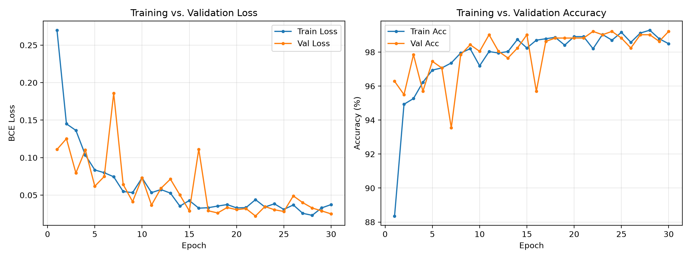
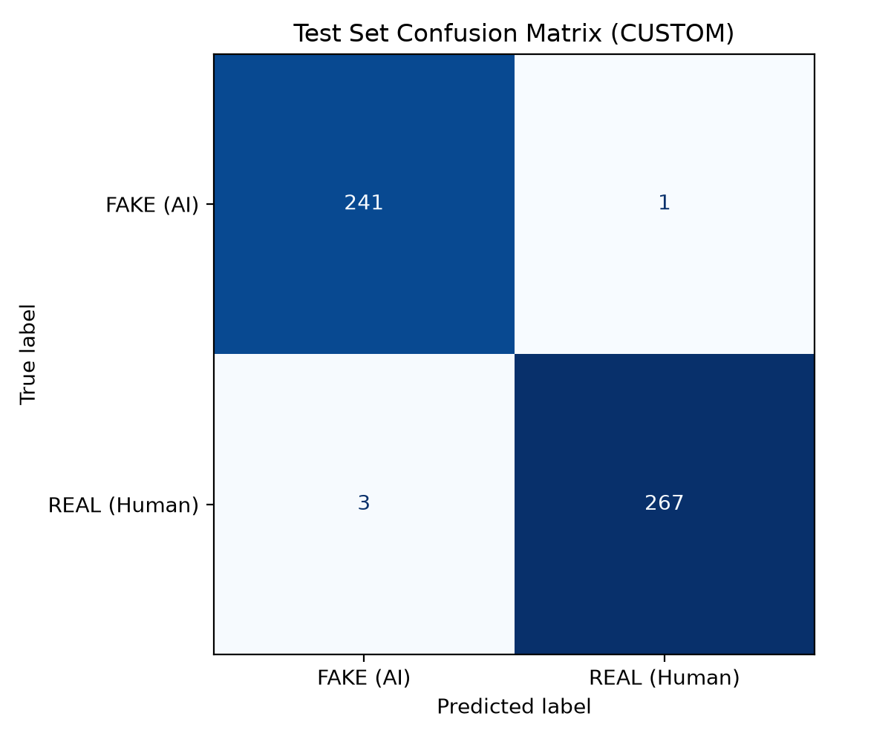
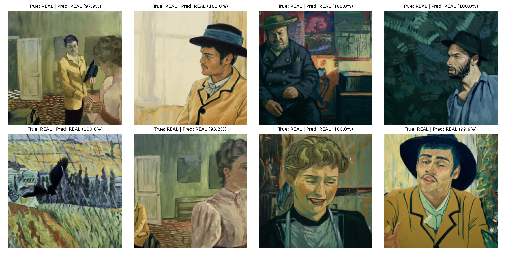

# AI-Generated Artwork Classifier (CNN)

A modular PyTorch proof-of-concept implementation of my 3rd-year undergraduate research paper, *"Artificial Intelligence-generated Artwork Classification Using Convolutional Neural Networks"* ([Read Original Paper](docs/Pornillos_AI_Art_Classification.pdf)).

## Overview
This project distinguishes human-painted post-impressionist artworks from latent-diffusion AI-generated images using a 4-layer Convolutional Neural Network (`Conv2d` → `BatchNorm2d` → `ReLU` → `MaxPool2d`) trained with binary cross-entropy loss (`BCEWithLogitsLoss`).

- **Dataset:** 3,408 post-impressionist images (`1,704 FAKE` / `1,704 REAL`) from [`birdy654/detecting-ai-generated-artwork`](https://www.kaggle.com/datasets/birdy654/detecting-ai-generated-artwork/data), split deterministically into 70% train, 15% validation, and 15% test sets.
- **Architecture:** Custom 4-layer CNN with adaptive average pooling, dropout regularization (`0.5`), and an optional `--model resnet18` transfer-learning toggle.
- **Scope & Limitations:** Trained specifically on post-impressionist artwork; serves as a domain-specific baseline rather than a general-purpose detector across modern diffusion architectures.

## Repository Structure
```text
ai-art-classifier/
├── assets/                  # Evaluation plots and sample inference grids
├── docs/                    # Original 3rd-year undergraduate research paper
├── src/
│   ├── dataset.py           # Deterministic train/val/test split & transforms
│   └── model.py             # Custom 4-layer CNN & ResNet18 definitions
├── train.py                 # CLI training pipeline with checkpoint saving
├── evaluate.py              # Test set metrics & visual artifact generator
├── predict.py               # Single-image CLI inference script
└── requirements.txt
```

## Quickstart

1. **Install dependencies:**
   ```bash
   python3 -m venv .venv
   source .venv/bin/activate
   pip install -r requirements.txt
   ```

2. **Download the dataset via Kaggle API:**
   ```bash
   kaggle datasets download -d birdy654/detecting-ai-generated-artwork -p data/raw --unzip
   ```

3. **Train and evaluate:**
   ```bash
   python train.py --data_dir data/raw --epochs 30 --batch_size 16 --model custom --save_path custom_cnn.pth
   python evaluate.py --data_dir data/raw --weights custom_cnn.pth --model custom
   ```

4. **Run single-image inference:**
   ```bash
   python predict.py --image "data/raw/REAL/REAL 23.jpg" --weights custom_cnn.pth
   ```

## Evaluation Results

Trained for 30 epochs (batch size 16, AdamW `lr=1e-4`), the model achieved **99.22% peak validation accuracy** and **99% overall accuracy** on the held-out test set (512 images):

| Class | Precision | Recall | F1-Score | Support |
| :--- | :---: | :---: | :---: | :---: |
| **FAKE (AI-Generated)** | 0.99 | 1.00 | 0.99 | 242 |
| **REAL (Human Artwork)** | 1.00 | 0.99 | 0.99 | 270 |
| **Overall / Macro Avg** | **0.99** | **0.99** | **0.99** | **512** |

### Training Curves


### Test Set Confusion Matrix


### Sample Test Predictions


Note: The MIT License applies to the source code in this repository; the dataset remains subject to the original authors' terms on Kaggle.

## Dataset Attribution
- **Dataset:** [`birdy654/detecting-ai-generated-artwork`](https://www.kaggle.com/datasets/birdy654/detecting-ai-generated-artwork/data)
- **Citation:** Bird, J.J., Barnes, C.M., Lotfi, A. (2024). *AI Generated Art: Latent Diffusion-Based Style and Detection*. Advances in Computational Intelligence Systems. UKCI 2023.
